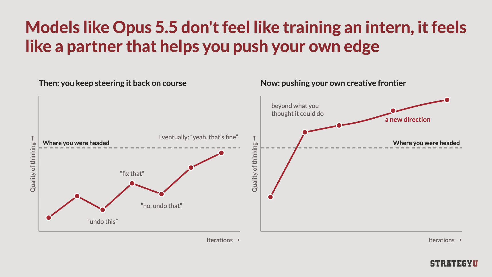
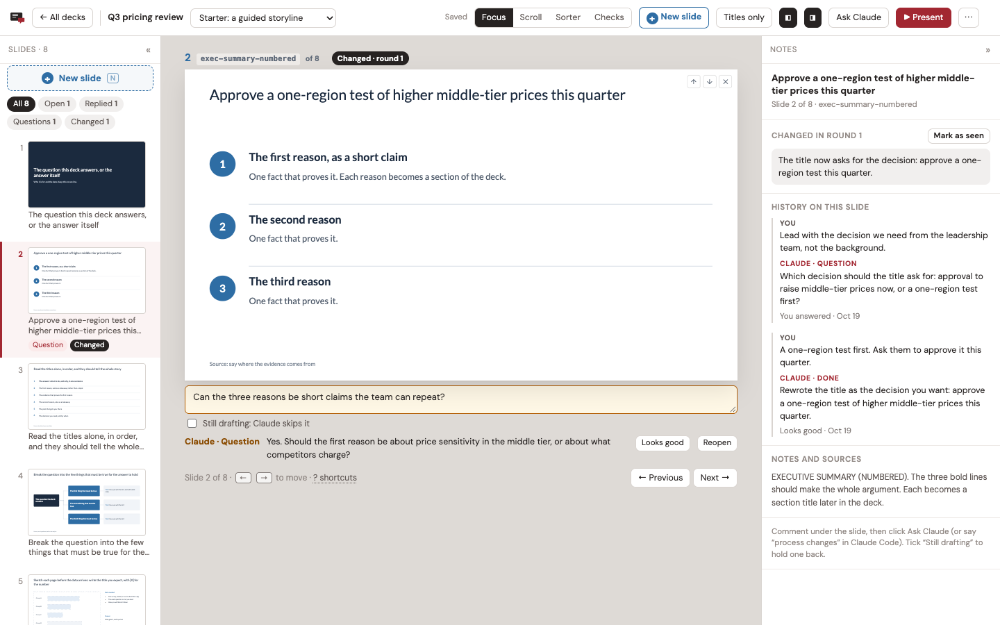

# Decks

**Performance fork:** persistent browser jobs, incremental saves, virtual slide/list
windows and on-demand slide data. See [measurements and tradeoffs](#performance).

Make slides by commenting on them. You leave a comment under a slide, your coding agent
(Claude Code or Codex) changes the deck, and it replies on the slide: what it did, a
question for you, or why it left something alone.


## Why I built this

I teach people consulting skills and a big part of my work is getting people to make
better and more compelling decks in PowerPoint. I made most of my slides in PowerPoint
too. Of course I did, I'm a former consultant.

With Astra and Opus 5.5, we've reached a tipping point. I think that bulky software like
Google Slides and PowerPoint increasingly doesn't make sense, especially for a solo
operator like me. Handling basic formatting is trivial now and you can play project
manager or partner, with the latest models as your Senior Associate. While I assume this
may continue to evolve and I'm sure Claude's slide project may eventually kick my ass,
for now, I am putting this out there as a simple harness that you can open in Claude or
Codex and work in iteratively.



Decks is built that way. You say what should change, your agent changes it, and it tells
you on the slide what it did and why. I have a tab, **Checks**, that offers some of the
tests I teach to teams and also still run on my own slides: five- and ten-second tests,
title tests, and horizontal and vertical flow. You can use AI as both a doer and a
teacher, so you learn the method and apply it at the same time, on your own work.

When I make slides now, this is my daily driver and harness. I'm not sure I'll ever align
boxes in PowerPoint again.

## A builder with a strong opinion

Decks is built on the ideas I teach at StrategyU, and the agent follows them every time it
writes or fixes a slide:

- **Answer first.** Lead with the recommendation, then the evidence. Build up to it only
  when the audience is skeptical.
- **Ghost deck first.** Write every title, in order, before building a single slide. It's
  the cheapest moment to fix the story. ([Ghost decks](https://strategyu.co/ghost-deck/))
- **Action titles.** Every title is a full sentence that says the point: "Q3 revenue grew
  22%, driven by enterprise expansion", not "Q3 Revenue".
  ([Action titles](https://strategyu.co/action-titles/))
- **Vertical flow.** The title matches the content: the body proves the title, and there's
  no takeaway box at the bottom.
  ([The principles of flow](https://strategyu.co/persuasive-powerpoint-storytelling-principles-of-flow/))
- **Horizontal flow.** Read only the titles, in order, and they tell the whole story.
- **The five-second test.** For a slide you present: glance at it for five seconds, and
  the one point comes through.
- **The ten-second test.** For a slide people read: they can take it in within ten
  seconds. One point, a clear hierarchy, a chart that reads without study.
  ([The ten-second test](https://strategyu.co/ten-second-test/))
- **"So what?"** A slide can be easy to read and still say nothing. Every slide tells the
  audience what to think. ([Pretty slide syndrome](https://strategyu.co/pretty-slide-syndrome/))
- **One idea per slide.** If it needs "and also", it's two slides.
- **Charts prove the title.** Bars, columns, and lines; the number that matters stands
  out; never a pie chart.
- **Draw the relationship.** No grids of identical boxes. Show the process, the spectrum,
  or the chart instead.

Most of these are one keypress away in **Checks**. The agent's version of the method is
in `.claude/skills/decks/SKILL.md`, and the full one is in my
[strategy-slides skill](https://strategyu.co/strategy-consulting-aiskills/).

## Recommended setup

I use Decks in the Claude and Codex apps, with the deck open in the app's built-in
browser, so the agent and I look at the same page. Models: Opus 5.5 or Sol 6.1. I haven't
tried others yet.

## Each deck is one file on your machine

Each deck is one HTML file in its own folder, with its own git history. It opens in any
browser, presents full screen, and prints to PDF. Decks runs on your machine and keeps
nothing anywhere else (your agent sends what it reads to its model provider, as it does
with any file). When you need to send a deck, **Client copy** gives you one file with
only the slides.

## Install

You need Python 3.9 or newer, Node.js 18 or newer, and git (optional, but decks get
version history with it). macOS and Linux.

```bash
git clone <this repository> decks
cd decks
./setup.sh
python3 server.py
```

Open http://localhost:8790/. The first start makes `~/slide-decks/` with the deck
registry (`decks.json`) and a demo deck to practice on.

The server needs only Python. Screenshots, the audit, PDF export, and dashboard
thumbnails use Node.js and a headless Chrome. `setup.sh` installs `playwright-core` into
`tools/` and, if it can't find a usable Chrome, Playwright's Chromium (about 150 MB, in
`~/Library/Caches/ms-playwright` on macOS or `~/.cache/ms-playwright` on Linux). On
Linux, if screenshots or PDFs fail, Chrome is missing system libraries:
`(cd tools && sudo npx playwright-core install-deps chromium)`.

### Updates

Decks has numbered versions. [CHANGELOG.md](CHANGELOG.md) says what changed in each, and the
dashboard footer shows the version you're running. When a new version is out, the dashboard
says so. To update, run `git pull` here and restart the server. To hear by email, watch the
repository on GitHub (Watch › Custom › Releases).

To know about new versions, the server asks GitHub once a day which release is newest: one
small request, read from a redirect. GitHub sees your IP address and that a check happened.
Nothing about your decks is sent. To turn it off, set `"check_updates": false` in
`config.json`, or `SB_CHECK_UPDATES=0`.

### Settings

Defaults: port 8790, listening on 127.0.0.1, decks in `~/slide-decks`. To change them,
copy `config.example.json` to `config.json`, or set environment variables (they win):

| Setting | `config.json` | Environment |
|---|---|---|
| Port | `port` | `SB_PORT` |
| Address to listen on | `host` | `SB_HOST` |
| Decks folder (also holds `decks.json` and `settings.json`) | `decks_dir` | `SB_DECKS_DIR` |
| Ask GitHub once a day for new versions (`true`) | `check_updates` | `SB_CHECK_UPDATES` |
| A different config file | | `SB_CONFIG` |
| Where `sb` finds the server | | `SB_URL` |
| Chrome for the headless jobs | | `SB_CHROME` |

`python3 server.py --port 8799` changes the port for one run.

## How a round works

1. **You comment.** Write what should change in the box under a slide, or click any text
   on the slide and fix it yourself. It saves to disk next to the deck as you type.
2. **You hand it to the agent.** Click **Ask Claude** in the top bar. It copies a prompt
   with the deck file and the steps; paste it into Claude Code or Codex. With the `decks`
   skill installed, you can just say "process changes".
3. **The agent edits and replies.** It reads your comments and edits with `sb comments`
   and `sb edits`, changes the deck file, and answers each comment on its slide with
   `sb reply`. You see "Claude working" on the slide while it goes.
4. **The agent checks its work.** It screenshots the slides it touched, runs the audit,
   exports the next numbered PDF, records the round, and commits the deck folder.
5. **You review.** The page reloads once you stop typing. Replies sit under their slides,
   and changed slides carry a badge. **Looks good** clears a comment; **Reopen** sends it
   back.

Each slide keeps its history in the side panel: every comment, the agent's reply, and
how it ended.



## Checks: the tests I teach, one key each

Press C, or a number key from any view to run that check on the slide you're on. Not sure
which? **Help me choose** asks what you want to know and opens the check that answers it.

1. **5-second test.** Can you get the point of the slide at a glance?
2. **10-second test.** Can a reader take it in, in the time they'll give it? A miss on
   either timed test (M) leaves a comment on the slide for the next round.
3. **Horizontal flow.** The titles alone, in order, as paragraphs or one per line. They
   should tell the whole story. You can edit them right there.
4. **Vertical flow.** The title first, with the body hidden. Say what the slide has to
   prove, then press Space and check that it does. It finds the title wherever your layout
   puts it, even inside a column or panel.
5. **Guides.** Four basic rules drawn on every slide, with a list of the slides that
   break one:
   - the protected border, kept for the logo, source line, and page number;
   - titles of two lines at most (title, section, closing, and statement slides are
     exempt);
   - no text under 12 px on the 1000 px slide;
   - no more than four text sizes on a slide.

   They're guidelines. They flag problems and never block you. **Ask Claude to fix** adds
   what a slide breaks to its comment (**Comment on all** does every flagged slide), and
   the agent fixes it next round. `sb audit` runs the same check, plus overflow and
   overlapping labels.

You can comment from any check except the timed tests: the comment box stays under the
slide.


## Working in a deck

Four views, each with the slides on the left and the notes on the right:

- **Focus** (F): one slide, its comment box, and the agent's reply.
- **Scroll** (S): the whole deck, with comments and replies under each slide.
- **Sorter** (G): drag thumbnails to reorder, × to leave a slide out, and a shelf to bring
  slides back.
- **Checks** (C): above.

**Titles only** (H) hides everything but the titles, in any view. `?` lists every
shortcut. The version menu switches between a deck's versions (say, the full deck, a
short cut, and a facilitator pack), which share slides.

### Add a slide

Press N, click **New slide** in the top bar or the filmstrip, or click the + between two
slides. **Help me choose** asks what you're trying to show and suggests layouts. **Basic
layouts** and **All layouts** show what the deck carries. **Add slide** puts one where you
clicked; **Copy prompt** hands your agent a layout the deck doesn't have yet.

Every deck carries guided basic layouts (`templates/_engine/basics.js`): a big number,
points, two columns, a process, a table, quotes, a section divider, a question, an
exercise, and three picture layouts. Click a picture, or drop an image file on it, to put
your own in. It's saved next to the deck.


### Send a client only the slides

The ⋯ menu in the top bar has two copies:

- **Client copy**: the version on screen, slides only, as they look now. Notes, comments,
  facilitator slides, other versions, and editing are left out, so they aren't in the
  file's source either. It's one file with its pictures inside. It scrolls, prints one
  slide per page, and presents full screen (P).
- **Editable copy**: the whole deck with its notes and comments, for you.

`sb export` prints the deck file to PDF. If the browser holds edits that aren't in the
file yet, it says so; `--with-edits` prints what the browser shows instead.

### Two tabs and a dropped connection don't lose your work

Each save carries what the page started from, and the server merges it with anything
another tab saved in the meantime. Two tabs on the same deck keep both sets of changes,
and the other tab offers a reload. A save that fails stays in the browser and is retried
until the server answers.

## Starting a deck

Click **New deck** on the dashboard. First, a name, what you're making (a presentation, a
training, a talk, a proposal, or a blank deck), and any pieces to build alongside it, like
a facilitator pack or a short version. Then who it's for, what they know, and the one
point they should leave with, plus optional length, structure, density, colors, title
font, logo, and notes.

**Create deck** sets up the folder and its git history, writes your brief to `BRIEF.md`,
copies a prompt for your agent, and opens the deck. Paste the prompt, and the agent builds
the first draft from your brief.

From the command line:

```bash
./sb templates
./sb new "Q3 pricing review" --template consulting --audience "The leadership team" \
  --point "Raise prices on the middle tier first." --style Navy
```

Templates (`templates/<id>/`):

| Template | What it is |
|---|---|
| `consulting` | A guided storyline in eight slides: cover, executive summary, storyline, hypothesis tree, ghost chart, 2x2, plan, and next steps. Every line says what goes there. Built from my [free consulting PowerPoint templates](https://strategyu.co/strategy-consulting-powerpoint-templates/) (100+ slides). |
| `talk` | An opening, three parts with dividers, and a close |
| `workshop` | A training day: agenda, modules, practice, breaks, and a facilitator pack |
| `proposal` | Situation, approach, team, fees, and next steps |
| `blank` | A title, one part, two slides, and a close |

Colors: Navy, Dark, Minimal, Forest, Teal, or Plum, with serif or sans serif titles.
They're written into the deck as one `<style id="deck-theme">` block, so you can restyle
the whole deck in one place. Upload a logo and it goes in the corner of every slide.

## The dashboard


Every deck with its open comments, latest PDF, and recent rounds. The ⋯ on a deck hides
it (Show brings it back from the Hidden list at the bottom) or deletes it. Delete moves a
deck this app made to the Trash. A deck you registered from a folder of your own only
leaves the dashboard; its files stay where they are.

## Use it with your agent

The agent's instructions are in `.claude/skills/decks/SKILL.md`: the round procedure, the
`sb` commands, how a deck file is organized, and the slide style rules.

- **Claude Code** finds the skill when you start it in this folder. To use it from
  anywhere, copy it to your user skills:
  `mkdir -p ~/.claude/skills && cp -r .claude/skills/decks ~/.claude/skills/`
- **Codex** and other agents read `AGENTS.md` in this folder, which points to the same
  file.

The Ask Claude prompt works without the skill, because it lists the `sb` steps itself.

## `sb`

Run it from this folder (or by its full path). It talks to the running server.

| Command | What it does |
|---|---|
| `sb decks` | Every deck, with open comments and questions |
| `sb comments <deck> [--all]` | Comments to act on, numbered like the deck (`--all` adds drafts) |
| `sb edits <deck> [--version v]` | Text the reviewer edited on the slides, and slide moves |
| `sb working <deck> <slide>` | Show "Claude working" on a slide |
| `sb reply <deck> <slide> done\|question\|skipped "<text>"` | Reply on a slide |
| `sb status <deck> "<text>" [--done N --total M]` | The live line in the top bar; `sb idle <deck>` clears it |
| `sb shot <deck> [--version v] [--out DIR] <slide> ...` | Screenshots of slides |
| `sb audit <deck> [--version v]` | Overflow, overlapping labels, and the Guides |
| `sb export <deck> [--version v] [--with-edits]` | The next numbered PDF; older ones move to `_archive/` |
| `sb round <deck> --summary S [--changed slide="what changed" ...] [--export vN]` | Record a round |
| `sb commit <deck> "<message>"` | Commit the deck folder |
| `sb thumb <deck>` / `sb url <deck>` | Refresh the dashboard thumbnail / print the deck's address |
| `sb templates` / `sb new "<name>" [--template id] ...` | Templates, and a new deck |
| `sb hide <deck>` / `sb show <deck>` | Take a deck off the dashboard, or put it back |
| `sb delete <deck> --yes` | Delete a deck (a deck this app made goes to the Trash) |

## Run it at login (optional)

macOS (launchd):

```bash
sed -e "s|__APP__|$PWD|g" -e "s|__HOME__|$HOME|g" contrib/decks.plist > ~/Library/LaunchAgents/local.decks.plist
launchctl load ~/Library/LaunchAgents/local.decks.plist
```

Restart it with `launchctl kickstart -k gui/$(id -u)/local.decks`. The log is
`~/Library/Logs/decks.log`.

Linux (systemd user service):

```bash
mkdir -p ~/.config/systemd/user
sed "s|__APP__|$PWD|g" contrib/decks.service > ~/.config/systemd/user/decks.service
systemctl --user enable --now decks
```

## How it works

| File | What it does |
|---|---|
| `server.py` | Serves the dashboard and the decks, saves state, and runs the JSON API `sb` uses (Python standard library only) |
| `sbconfig.py` | Port, address, and decks folder, from `config.json` and `SB_*` variables |
| `sb` | The agent's command line |
| `newdeck.py` | Themes, templates, and new decks (used by the server and `sb new`) |
| `library.py` | Safe data-literal extraction, chunk generation and bounded serving cache |
| `templates/` | `_engine/engine.html` (the deck engine), `_engine/basics.js`, and one folder per template |
| `static/` | The browser shell: `boot.js`, `shell.js`, `shell.css`, `library.js` (embedded in new engines), `guides.js`, `addslide.js`, `pictures.js`, `clientcopy.js`, and `dashboard.html` |
| `tools/browser.mjs` | CLI and private local worker for headless Chrome jobs |
| `tools/browser-jobs.mjs` | Titles, edits, shots, audit, PDF, and thumbnail jobs, with a fresh browser context per job |
| `tools/pptx2native.py` | Converts PowerPoint slides into editable native slides (how the consulting starter was made) |

When the server serves a deck page, it adds a small boot script that loads the deck's
saved state and mirrors later saves back to disk, then removes its own tags before the
deck runs. The deck file itself never changes, so a saved copy is still a clean file.
`?raw=1` serves the file without the shell around it. (In a browser that has edited the
deck, it still shows those saved edits.)

Headless commands start a private worker automatically and reuse its Chrome process.
Jobs are serialized and get fresh browser contexts, keeping saved edits separate from
raw exports. Export checks, PDF generation, and the dashboard thumbnail run in one job.
The worker closes Chrome after two idle minutes; `SB_BROWSER_IDLE_MS` changes that
timeout. `node tools/browser.mjs worker-status` reports its state and `worker-stop`
closes it. `SB_BROWSER_WORKER=0` runs without the worker for diagnostics.

Jobs wait for page load, fonts, image decoding, and two animation frames instead of
fixed sleeps. A deck with asynchronous chart work can publish a promise as
`window.__DECK_READY`; readiness has a 30-second timeout.

New decks cache unchanged editable fields and default hashes while saving. Existing
deck files keep their embedded engine; they still get smaller network saves through
the shared boot script. Saves send changed object leaves (slide fields, individual
comments, or the order), and the server merges them into the existing `state.json`
format. Full localStorage snapshots and pending-save backups remain available for
offline recovery and portable copies. Local snapshots and disk writes still serialize
the complete saved state; this is not a new incremental database format.

Interactive decks with at least 80 slides render slide bodies on demand. Focus keeps
the current slide and its neighbors; Scroll renders near the viewport and releases
distant bodies. Thumbnail bodies are released when they leave the thumbnail viewport.
The logical model retains order and comments while wrappers are unmounted, and edited fields survive eviction,
undo, version switches, and reload. Untouched slide defaults need no saved field copy.
Whole-deck checks, printing, client copies, and headless raw/saved exports still render
all required slides. Add `?lazy=0` to compare with eager rendering. Existing deck files
keep their embedded engine; newly generated decks get this behavior.

Large filmstrips and excluded-slide shelves mount just their visible rows plus a small
buffer. Keyboard focus, drag reorder, filters, and distant slide jumps use the full
logical order. Large interactive decks skip the hidden legacy sidebar and use the
same library selection model for the filmstrip, sorter, and Add slide picker. Empty
review controls and insertion buttons are created where needed, and the first layout
waits for the shell's view classes. `?lists=0` disables list windowing for diagnosis;
`?lazy=0&lists=0` also restores eager slide bodies.

Saved next to each deck, in `.slidebuilder/`:

- `state.json`: the reviewer's edits, comments, and slide order, mirrored from the page.
- `review.json`: the agent's replies, rounds, history, and "changed" badges, written
  through `sb`.

**Hide client work** (dashboard) is for recording or screen sharing. Mark a deck
`"client": true` in `decks.json`, or list client versions in `"clientVersions"`. With
the switch on, the server leaves them out of everything it serves.

API (what `sb` uses):

- `GET /api/decks`, `GET /api/decks/<slug>`: summaries.
- `GET /api/decks/<slug>/comments`: open comments, with the agent's reply if there is one.
- `GET|PUT /api/decks/<slug>/state`: the deck's saved browser state.
- `GET /api/decks/<slug>/review`, `POST /api/decks/<slug>/review`: replies, live status,
  and rounds. The agent posts `{op: 'reply' | 'claude' | 'round'}`; the page posts
  `{op: 'comment-state' | 'resolve' | 'reopen' | 'seen'}`.
- `GET /api/decks/<slug>/pulse`: modified times, polled by the page for live updates.
- `GET /api/templates`, `POST /api/new-deck`: templates and new decks.
- `POST /api/decks/<slug>/manage`: `{op: 'hide' | 'show' | 'delete'}`.
- `POST /api/decks/<slug>/bundle`: a copy of the deck with its pictures and scripts embedded.
- `POST /api/decks/<slug>/upload`: a picture for a slide, saved in the deck's `img/uploads/`.

<!-- library-performance:start -->
## Performance

This fork combines a persistent headless-browser worker, incremental network saves,
virtual slide wrappers and lists, and on-demand slide data. The earlier measurements
below document each step; they are not multiplicative claims about the entire app.

### On-demand slide libraries

Newly generated engines support serving large data-only `LIBRARY` declarations and
`Object.assign(LIBRARY, ...)` blocks as a metadata index plus content-addressed JSON
chunks of 64 definitions. Blocks under 256 entries and blocks containing functions,
references or other unsupported JavaScript expressions remain embedded. The first
chunk and copyable basic layouts stay available immediately; later bodies, tables,
pictures and notes load when navigation or a visible thumbnail needs them. Metadata
still grows with library size, so startup is not constant-time.

The server derives these resources without executing deck code or changing the deck
file. Its cache holds eight files, checks nanosecond timestamps/inodes/sizes, and drops
old revisions. Chunk requests use SHA-256 URLs; an unavailable revision returns 409.
Requests share in-flight work, use at most six concurrent fetches, and retry after
failures. Late requests, stale Scroll timers and rapid keyboard steps preserve the
latest requested selection. Gzip reduces large HTML/JSON transfer sizes.

Whole-deck operations wait for their definitions. App printing awaits data, fonts and
images; native browser-menu printing has a synchronous `beforeprint` fallback because
that event cannot await a promise. Editable copies fetch and bundle the complete
original source, including edits, for offline use. Raw/readonly exports remain eager.
Existing files retain their embedded engine; newly generated files receive this loader.

Agent integrations should `await SlideBuilder.go(id)`, `await SlideBuilder.setView('checks')`,
`await DeckRenderer.all()`, `await SBGuides.scan()` and `await SlideBuilder.clientCopy()`.
These work with both immediate and asynchronous results. For a cold preview or direct
mount, first `await DeckData.load([id])`, then call `DeckRenderer.preview(id)` or
`DeckRenderer.ensure(id)`. The logical-order and offscreen-comment APIs still work
without loading a body. `?library=0` disables data splitting; `SB_SPLIT_LIBRARY=0`
disables it for a scratch server, and `SB_GZIP=0` disables compression.

Five interleaved trials against `7543103`, using matching mixed-layout fixtures,
fresh browser contexts, 1600×1000 viewports and equal external-font blocking on the
provided Linux VM (24 logical CPUs, 61 GiB RAM). Startup fixtures have no saved edits;
the edit/save exercise runs afterward. The table has a warm server transform
cache and cold browser HTTP caches. Startup ends at `sb-ready` plus two frames;
browser/server process launch is excluded. Navigation measurements now await the
actual target body and assert that it is displayed.

| Slides | Startup before → after | HTML body transferred | Decoded HTML |
|---:|---:|---:|---:|
| 1,000 | 227 → 208 ms | 758 → 109 kB | 0.76 → 0.50 MB |
| 5,000 | 318 → 254 ms | 2488 → 141 kB | 2.49 → 1.08 MB |
| 10,000 | 455 → 276 ms | 4652 → 177 kB | 4.65 → 1.82 MB |

At 10,000 slides this is **1.65× faster startup** and
**96.2% fewer HTML transfer bytes**.
Complete definitions at startup fall from 10,077 to 141
(the latter includes starter/basic layouts). The first distant jump costs
4.9 → 14.3 ms, including its cold data fetch;
repeat navigation reuses the loaded group. DOM remains bounded at two startup wrappers.

**Cold cache cost matters.** Invalidating the server transform cache before each open
measured 416 → 401 ms at 10,000 slides,
and 285 → 228 ms at 1,000 slides. Small cold opens
can be slower; cache construction is not hidden in the warm figures. Under 4× browser
CPU throttling, 10,000-slide startup measured 1694 → 940 ms.
A separate 15-trial small-deck check measured blank: 199 → 206 ms; workshop: 225 → 226 ms.
Absolute timings vary across VM passes; compare paired figures from the same pass.
These results do not establish 100× overall application performance.

### Rust assessment

No Rust rewrite is included. The separate 10,000-slide sample reduced source compile
time from 63.5 to 11.0 ms by removing work.
Warm scripting in the timed run takes about 54 ms of 276 ms total;
even making all of it free would only imply roughly 1.24× in that simplified model.
That is an inference, not a measured Rust speedup. Browser layout and PDF rendering
would still run in Chromium. WebAssembly calls browser APIs through JavaScript/bindings,
as described by [MDN](https://developer.mozilla.org/en-US/docs/WebAssembly/Guides/Concepts)
and the [wasm-bindgen guide](https://wasm-bindgen.github.io/wasm-bindgen/web-sys/index.html).

Cold index construction is the plausible native-code candidate, but it is paid once
per changed/evicted file or server restart. Parsing, JSON encoding and hashing
already use native standard-library routines. A persisted generated index/chunk cache is the next
lower-complexity experiment. Large imports or geometry batches would need their own
profile before adding a Rust boundary. Complete title/order metadata and populated
saved-state bootstrap data remain further measurement targets. The current evidence
supports reducing data and DOM work rather than rewriting the UI language.

### Reproduce and validate

Generate disposable fixtures in both the baseline and current checkouts with
`BENCH_SIZES=100,500,1000,5000,10000 python3 tests/prepare-performance.py /tmp/decks-perf`.
Start separate scratch servers with different ports and `SB_DECKS_DIR` values. Set
`SB_URL`, `BASELINE_URL` and `SB_CHROME` for:

```sh
node tests/benchmark-library.mjs
BENCH_FIXTURES=1000,10000 CPU_RATE=4 node tests/benchmark-library.mjs
node tests/benchmark-library-cold.mjs
BENCH_FIXTURES=blank,workshop BENCH_TRIALS=15 node tests/benchmark-library.mjs
PROFILE_SLUG=bench-large-10000 node tests/profile-startup.mjs
python3 -m unittest discover -s tests
node --test --test-concurrency=1 tests/browser.test.mjs tests/lazy.test.mjs tests/lists.test.mjs tests/wrappers.test.mjs tests/library.test.mjs
node tests/stress-wrappers.mjs
```

The cold-cache script touches fixture files and must run on the machine hosting the
scratch servers. Tests clear fixture state. Keep functional stress, profiling and
export checks separate from timed runs. Historical synchronous-navigation benchmark
scripts should use `SB_SPLIT_LIBRARY=0`; the library benchmark awaits cold navigation.

Validation: 64 distinct automated tests, focused Scroll-race rechecks, eight parallel
10,000-slide viewport/CPU scenarios, five template audit/export runs, 52 matching
PDF pages, identical text for the 100-slide PDF with three raster spot checks, eight
matching viewport frames, and a real 1,000-page live print containing an edited final
slide and returning to seven wrappers. Consulting's existing `sample-2x2` text-size
advisory remains. The new tests also cover offline editable copies, retry behavior,
stale chunks, request ordering, rapid keys, default notes and gzip negotiation.

Raw samples, source hashes and validation are in
[`library-linux.json`](tests/benchmarks/library-linux.json), and diagnostic CPU samples
are in [`library-profile-linux.json`](tests/benchmarks/library-profile-linux.json).

### Earlier iterations
<!-- library-performance:end -->

Regression checks: `python3 -m unittest discover -s tests` tests state merges and library extraction/cache behavior.
With a scratch server and `Bench blank`, `Bench talk`, and `Bench workshop` decks, run
`SB_URL=http://127.0.0.1:8799 SB_CHROME=/path/to/chrome node --test tests/browser.test.mjs`.
The browser tests clear the blank scratch deck's saved state and need Poppler's `pdftotext`. `tests/benchmark.mjs`
compares real CLI jobs and save requests against an unmodified checkout; its header
lists the required environment variables.

For large-deck tests, `python3 tests/prepare-performance.py /tmp/decks-perf` creates
disposable standard templates and mixed-layout 100/500/1000-slide fixtures. Start the
server with that `SB_DECKS_DIR`, then run `node --test tests/lazy.test.mjs` with `SB_URL`
and `SB_CHROME`. These tests clear the 500-slide fixture's saved state. To benchmark,
run `node tests/benchmark-lazy.mjs` with `BASELINE_URL` pointing at the previous version's
matching fixtures. External font requests are blocked equally during that benchmark
to isolate rendering work; startup and navigation samples are recorded separately.

For the 1,000-slide mixed-layout fixture, five-run medians against the prior worker /
incremental-save version were:

| Operation | Before | Lazy rendering |
|---|---:|---:|
| Page ready | 2,275 ms | 694 ms |
| Engine render and restore | 1,434 ms | 174 ms |
| First save-state collection + JSON | 228.4 ms | 2.1 ms |
| Warm save-state collection + JSON | 5.4 ms | 0.9 ms |
| Main-deck bodies at startup | 1,000 | 2 |

The first-save result has cold default hashes in the baseline; it is not a claim of
100x overall application speed. Navigation remained similar in that step. Save
collection excludes debounce, network and disk time. Raw samples and source hashes are in
[`tests/benchmarks/lazy-linux.json`](tests/benchmarks/lazy-linux.json).


The next iteration profiles and windows the lists. Generate matching fixtures from
both checkouts and run `node tests/benchmark-lists.mjs` with `BASELINE_URL`, `SB_URL`,
and `SB_CHROME`. Set `ORIGINAL_URL` to include an unmodified upstream checkout.
The benchmark reverses run order on alternate trials, uses fresh contexts in an
existing Chrome process, and blocks Google font CSS equally. It excludes browser
launch and server startup. `node tests/profile-startup.mjs` captures a separate CPU
profile; `node --test tests/lists.test.mjs` exercises the virtual lists and clears the
1,000-slide scratch fixture's saved state.

Five-run medians against `1a31d1a` (the previous lazy-slide version), at 1,000 slides:

| Operation | Previous fork | Windowed lists |
|---|---:|---:|
| Page ready + two frames | 619 ms | 301 ms |
| Engine render and restore | 161.3 ms | 55.6 ms |
| Synchronous navigation | 17.0 ms | 7.5 ms |
| Navigation + two frames | 33.5 ms | 33.3 ms |
| Layout work during startup | 169.2 ms | 57.2 ms |
| DOM elements at startup | 33,059 | 9,669 |
| Filmstrip rows at startup | 1,000 | 8 |

Startup improves another **2.06x**, and **6.45x** against fresh runs of upstream
`8a5179b` (1,942 ms). At 500 slides the previous fork's 429 ms becomes 256 ms;
at 100 slides, 256 ms becomes 223 ms. Small decks remain roughly unchanged
(blank: 200 to 206 ms; workshop: 240 to 226 ms). The two-frame navigation measure
remains near the display's frame cadence, even though synchronous work drops.
These results do not establish 100x overall performance.

That iteration left 9,099 elements inside the main deck. Wrapper/comment
construction, slide numbering, initial layout, and loading/parsing the full embedded
library remain costs that grow with deck size. The visible lists were bounded; main-deck wrappers still scaled with the deck.
Raw samples, source hashes and validation are in
[`lists-linux.json`](tests/benchmarks/lists-linux.json); sampled function costs are in
[`lists-profile-linux.json`](tests/benchmarks/lists-profile-linux.json).


The wrapper iteration moves the full logical order, edited fields, and feedback into
a model independent of mounted DOM. Focus keeps the current wrapper and neighbors;
Scroll keeps a viewport window, using estimated heights corrected by observed sizes.
Prefix sums provide logarithmic offset lookup and updates, and height corrections
preserve the visible anchor. Numbering touches only mounted wrappers; indexes rebuild on structural or width
changes rather than on every navigation. Review counts scan metadata once, and layout
avoids resetting widths or rewriting unchanged transforms on every navigation.

`SlideBuilder.slides()` and `__DECK_STATE()` still return the complete deck.
Use `SlideBuilder.comment(id)` to read a comment and `SlideBuilder.comment(id, text)`
to update one, including an unmounted slide. `DeckRenderer.ids()` returns a read-only
logical order; querying `#deck` sees only mounted wrappers. `?wrappers=0` retains the
previous body-only lazy mode for diagnosis. Raw/readonly exports and standalone
copies remain eager. Existing files retain their embedded engine; these changes
apply to newly generated files. Sorter cards and whole-deck checks/exports still do
work proportional to deck size; leaving bulk views releases their extra DOM.

Five-run medians against `0d14a67`, with matching mixed-layout fixtures:

| Slides | Startup before → after | Navigation JS before → after | Enter Scroll before → after |
|---:|---:|---:|---:|
| 1,000 | 320 → 242 ms | 9.2 → 4.4 ms | 107 → 35 ms |
| 5,000 | 759 → 374 ms | 27.5 → 5.1 ms | 532 → 35 ms |
| 10,000 | 2,007 → 705 ms | 77.3 → 6.4 ms | 1,601 → 34 ms |

At 10,000 slides, startup improves **2.85x**, synchronous navigation **12.1x**,
and entering Scroll **46.9x**. Settled main-deck scroll jumps fall from 391 to 33 ms.
Startup DOM elements fall from 90,669 to 687; mounted wrappers fall from 10,000 to 2
at startup and stay at seven in these scroll samples. Serialized state sizes match.
These are specific operations, not a claim of 100x overall application performance.

Small-deck timings varied in the first five-run sweep. A separate 15-run follow-up
measured blank startup at 212 → 217 ms and workshop at 230 → 235 ms, roughly unchanged.
With equal 4x CPU throttling at 1,000 slides, startup is 872 → 620 ms and entering
Scroll is 363 → 55 ms. Both versions use fresh contexts, equally blocked Google font
CSS, reversed run order on alternate trials, and an already running browser/server.
Engine initialization timing excludes useful layout deferred to the shell; total
startup and browser layout metrics are recorded separately.

The final 10,000-slide profile removes the large wrapper-construction/numbering
costs. Full-library transfer and compilation, initial shell/layout work, and metadata
scans remain. The sampled source compile time was about 58 ms in both versions;
wrappers do not make loading the full embedded library constant-time.

Reproduce with this version's `tests/prepare-performance.py` in both checkouts (copy
only that fixture helper into the baseline checkout), using
`BENCH_SIZES=100,500,1000,5000,10000`. Start separate scratch servers, then run
`node tests/benchmark-wrappers.mjs` with `BASELINE_URL`, `SB_URL`, and `SB_CHROME`.
`BENCH_FIXTURES=1000 CPU_RATE=4` runs the throttled case. Run the browser suites with
`node --test --test-concurrency=1 tests/browser.test.mjs tests/lazy.test.mjs tests/lists.test.mjs tests/wrappers.test.mjs`;
they clear disposable fixture state and need Poppler. Separately run
`node tests/stress-wrappers.mjs` for eight parallel viewport/CPU scenarios, and
`PROFILE_SLUG=bench-large-10000 node tests/profile-startup.mjs` for diagnostic samples.

Validation includes 41 automated tests, eight parallel 10,000-slide scenarios across
four viewports and normal/4x CPU throttling, all five template audit/export runs,
52 matching template PDF pages, eight matching focus frames across resizes, and a
real 1,000-page print from virtual Scroll with an edited final slide. A print-only
banner padding bug found by that check is fixed; printing then releases the bulk DOM.
Raw samples, hashes, follow-up runs and validation are in
[`wrappers-linux.json`](tests/benchmarks/wrappers-linux.json); sampled function costs
are in [`wrappers-profile-linux.json`](tests/benchmarks/wrappers-profile-linux.json).

## License

The code is MIT (`LICENSE`). The template content (the slides, their wording, and their
notes) is CC BY 4.0 (`LICENSE-templates`). Decks you make are yours, and you can send
them to anyone: each deck file carries a copy of the deck engine with its MIT notice.
Fonts: `NOTICE`.

## Contributing

Issues and ideas are welcome. I'm not taking outside code yet.
