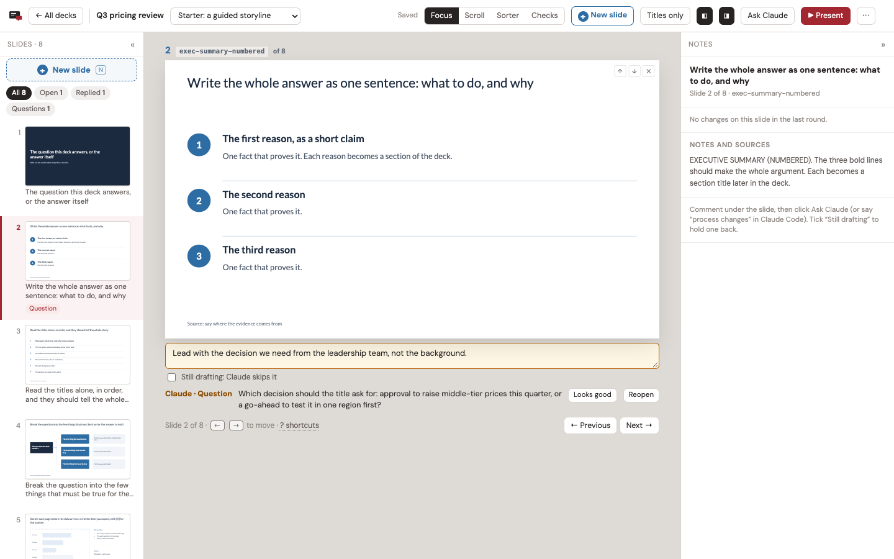
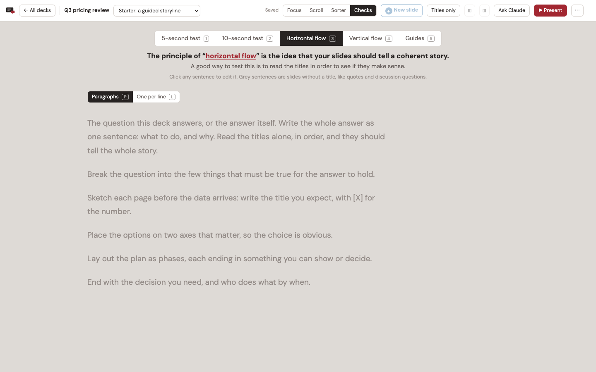
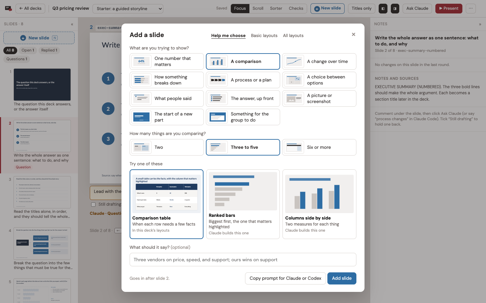
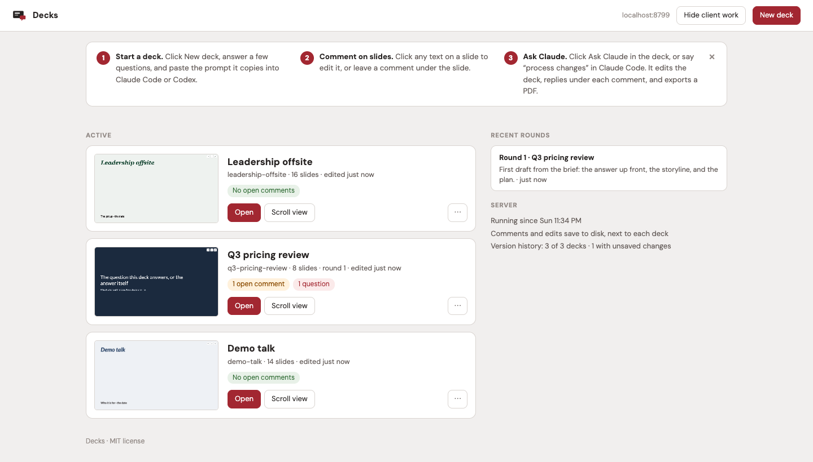

# Decks

Agent-first slide decks. You review a deck in the browser: leave a comment under any
slide, or click its text and edit it in place. Your coding agent (Claude Code or Codex)
reads those comments with the `sb` command, edits the deck file, and replies on each
slide: done, a question for you, or why it left something alone. The page updates while
it works.



## Why I built this

Most people learn how to make a good deck in one place and make their decks in another.
You take the course or read the book, then go back to your desk with a deadline, and the
method stays in your notes.

AI changes that. **You can use AI as both a doer and a teacher**, so you learn the
method and apply it at the same time, on your own work.

Decks is built that way. You say what should change, your agent changes it, and it tells
you on the slide what it did and why. Checks keeps the tests consultants use one
keypress away: read only the titles and see if they tell the story; look at a slide for
five seconds and see if the point lands. The guides flag what breaks a basic principle
of slide design. They're guidelines, not rules.

I spent nearly a decade in strategy consulting, at McKinsey and BCG, and I've taught
these skills through [StrategyU](https://strategyu.co) since 2017. I make my own
workshops and talks in Decks.

## What you get

Each deck is one self-contained HTML file in its own folder, with its own git history.
It opens in any browser, presents full screen, and prints to PDF. **Client copy** gives
you one file to send: the slides only, pictures inside, with a Present button.

- The server needs only Python 3. Screenshots, the audit, PDF export, and dashboard
  thumbnails use Node.js and a headless Chrome, which `setup.sh` installs.
- Everything runs on your machine, at `http://localhost:8790`.
- Code: MIT. Templates: CC BY 4.0.

## Install

You need Python 3.9 or newer, Node.js 18 or newer, and git (optional; decks get version
history with it). macOS and Linux.

```bash
git clone <this repository> decks
cd decks
./setup.sh
python3 server.py
```

Open http://localhost:8790/. The first start makes `~/slide-decks/` with the deck
registry (`decks.json`) and one demo deck to try things on.

`setup.sh` installs `playwright-core` into `tools/` and, if no usable Chrome is found,
Playwright's Chromium (about 150 MB, in `~/Library/Caches/ms-playwright` on macOS or
`~/.cache/ms-playwright` on Linux). On Linux, if screenshots or PDFs fail, Chrome is
missing system libraries: `(cd tools && sudo npx playwright-core install-deps chromium)`.

### Settings

Defaults: port 8790, listening on 127.0.0.1, decks in `~/slide-decks`. To change them,
copy `config.example.json` to `config.json`, or set environment variables (they win):

| Setting | `config.json` | Environment |
|---|---|---|
| Port | `port` | `SB_PORT` |
| Address to listen on | `host` | `SB_HOST` |
| Decks folder (also holds `decks.json` and `settings.json`) | `decks_dir` | `SB_DECKS_DIR` |
| A different config file | | `SB_CONFIG` |
| Where `sb` finds the server | | `SB_URL` |
| Chrome for the headless jobs | | `SB_CHROME` |

`python3 server.py --port 8799` overrides the port for one run.

## The round loop

1. **Comment.** Open a deck. Under each slide is a comment box. Write what should change,
   or click any text on the slide and fix it yourself. Everything saves to disk next to
   the deck (`.slidebuilder/state.json`), not just in your browser.
2. **Ask Claude.** Click **Ask Claude** in the top bar. It copies a prompt that names the
   deck file and the `sb` steps. Paste it into Claude Code or Codex. With the
   `decks` skill installed, you can just say "process changes".
3. **The agent works.** It runs `sb comments` and `sb edits`, changes the deck file, and
   replies on each slide with `sb reply`. You see "Claude working" on the slide and a live
   status line in the top bar.
4. **Check and finish.** The agent screenshots what it touched (`sb shot`), runs the
   audit (`sb audit`), exports the next numbered PDF (`sb export`), records the round
   (`sb round`), and commits the deck folder (`sb commit`).
5. **Review.** The page reloads once you stop typing. Each reply sits under its slide, and
   changed slides carry a badge. Click **Looks good** to clear a handled comment, or reply
   to keep it open.

## In the deck

Four views, each with the slides bar on the left and the notes bar on the right:

- **Focus** (F): one slide, its comment box, and the agent's reply underneath.
- **Scroll** (S): the whole deck, with comments and replies under each slide.
- **Sorter** (G): drag thumbnails to reorder, × to leave a slide out, and a shelf to add
  slides back.
- **Checks** (C): five checks, keys 1 to 5. From Focus or Scroll, the keys run that check
  on the slide you are on.
  1. 5-second test: can you grasp the slide at a glance?
  2. 10-second test: is it legible in the time a reader gives it? A miss in either timed
     test (M) leaves a comment on the slide for the next round.
  3. Horizontal flow: the titles alone, as paragraphs or one per line, editable in place.
     Read them in order and they should tell the story.
  4. Vertical flow: the title first with the body hidden; Space reveals it. The body
     should prove the title.
  5. Guides (below).



**Titles only** (H) hides everything but the titles, in any view. `?` lists every
shortcut. The version menu picks between a deck's versions (a full deck, a short cut, a
facilitator pack), which share slides.

### Guides

Checks › Guides draws four basic principles on each slide and lists every slide that
breaks one:

- the protected border, a band around the edge kept for the logo, source line, and page
  number;
- titles of two lines at most (title, section, closing, and statement slides are exempt);
- no text under 12 px on the 1000 px slide;
- no more than four text sizes on a slide.

They are guidelines, not rules: they flag, never block. `sb audit` runs the same check,
plus overflow and overlapping labels.

### Add a slide

Press N, click **+ Slide** in the top bar, or click the + between slides. **Help me
choose** asks what you're trying to show and suggests layouts; **Browse all layouts**
shows every layout the deck carries. **Add slide** puts one right where you clicked.
**Copy prompt** gives your agent the deck file, the position, and what the slide should
say, for a layout the deck doesn't carry yet.

Every deck carries the basic guided layouts in `templates/_engine/basics.js`: a big
number, points, two columns, a process, a table, quotes, a section divider, a question,
an exercise, and three picture layouts (a picture with the point beside it, two
pictures, a full-screen photo). Click a picture, or drop an image file on it, to put
your own in; it is saved next to the deck.



### Sending a deck

The ⋯ menu in the top bar has two copies:

- **Client copy**: the version on screen as slides only, as they look now. No notes,
  comments, facilitator slides, other versions, or editing, so none of it is in the
  file's source either. One file with its pictures inside; it scrolls, prints one slide
  per page, and presents full screen (P).
- **Editable copy**: the whole deck with its notes and comments, for you.

`sb export` prints the deck file to PDF. If the browser holds edits that aren't in the
file yet, it says so; `--with-edits` prints what the browser shows instead.

### Two tabs, or offline

Each save carries what the page started from, and the server merges it with anything
another tab saved meanwhile, so two tabs on the same deck keep both sets of changes
(the other tab offers a reload). A save that fails is kept in the browser and retried
until the server answers.

## New deck

Click **New deck** on the dashboard. Step 1: a name, what you're making (a presentation,
a training, a talk, a proposal, or a blank deck), and the pieces to build alongside it,
such as a facilitator pack or a short version. Step 2: who it's for, what they know, and
the one point they should leave with, plus optional length, structure, density, colors,
title font, logo, and notes.

**Create deck** makes the folder, gives the deck its own storage prefix, adds it to
`decks.json`, starts its git history, writes the brief to `BRIEF.md`, copies a prompt
for your agent to your clipboard, and opens the deck. Paste the prompt and the agent
builds the first draft from the brief.

From the command line:

```bash
./sb templates
./sb new "Q3 pricing review" --template consulting --audience "The leadership team" \
  --point "Raise prices on the middle tier first." --style Navy
```

Templates (`templates/<id>/`):

| Template | What it is |
|---|---|
| `consulting` | A guided storyline in eight slides: cover, executive summary, storyline, hypothesis tree, ghost chart, 2x2, plan, next steps. Every line says what goes there. |
| `talk` | An opening, three parts with dividers, and a close |
| `workshop` | A training day: agenda, modules, practice, breaks, and a facilitator pack |
| `proposal` | Situation, approach, team, fees, next steps |
| `blank` | A title, one part, two slides, and a close |

Colors: Navy, Dark, Minimal, Forest, Teal, or Plum, with serif or sans serif titles. They
are written into the deck as one `<style id="deck-theme">` block, so you can restyle a
whole deck there. A logo you upload goes in the corner of every slide; without one,
slides have no logo.

## The dashboard



Every deck, with its open comments, latest PDF, and recent rounds. The ⋯ on a deck hides
it (into a Hidden list at the bottom, where Show brings it back) or deletes it. Delete
moves a deck this app made to the Trash; a deck you registered from a folder of your own
only leaves the dashboard, and its files stay where they are.

## Use it with your agent

The agent instructions are in `.claude/skills/decks/SKILL.md`: the round
procedure, the `sb` commands, how the deck file is organized, and slide style rules.

- **Claude Code** finds the skill on its own when you start it in this folder. To use it
  from anywhere, copy it to your user skills:
  `mkdir -p ~/.claude/skills && cp -r .claude/skills/decks ~/.claude/skills/`
- **Codex** and other agents read `AGENTS.md` in this folder, which points to the same
  file.

The Ask Claude prompt works without the skill: it lists the `sb` steps itself.

## `sb`

Run from this folder (or by its full path). It talks to the running server.

| Command | What it does |
|---|---|
| `sb decks` | Every deck, with open comments and questions |
| `sb comments <deck> [--all]` | Comments to act on, numbered like the deck (`--all` adds drafts) |
| `sb edits <deck> [--version v]` | Text the reviewer edited on the slides, and slide moves |
| `sb working <deck> <slide>` | Show "Claude working" on a slide |
| `sb reply <deck> <slide> done\|question\|skipped "<text>"` | Reply on a slide |
| `sb status <deck> "<text>" [--done N --total M]` | The live line in the top bar; `sb idle <deck>` clears it |
| `sb shot <deck> [--version v] [--out DIR] <slide> ...` | Screenshots of slides |
| `sb audit <deck> [--version v]` | Overflow, overlapping labels, and the Guides |
| `sb export <deck> [--version v] [--with-edits]` | The next numbered PDF; older ones move to `_archive/` |
| `sb round <deck> --summary S [--changed slide="what changed" ...] [--export vN]` | Record a round |
| `sb commit <deck> "<message>"` | Commit the deck folder |
| `sb thumb <deck>` / `sb url <deck>` | Refresh the dashboard thumbnail / print the deck's address |
| `sb templates` / `sb new "<name>" [--template id] ...` | Templates, and a new deck |
| `sb hide <deck>` / `sb show <deck>` | Take a deck off the dashboard, or put it back |
| `sb delete <deck> --yes` | Delete a deck (a deck this app made goes to the Trash) |

## Run it at login (optional)

macOS (launchd):

```bash
sed -e "s|__APP__|$PWD|g" -e "s|__HOME__|$HOME|g" contrib/decks.plist > ~/Library/LaunchAgents/local.decks.plist
launchctl load ~/Library/LaunchAgents/local.decks.plist
```

Restart it with `launchctl kickstart -k gui/$(id -u)/local.decks`; the log is
`~/Library/Logs/decks.log`.

Linux (systemd user service):

```bash
mkdir -p ~/.config/systemd/user
sed "s|__APP__|$PWD|g" contrib/decks.service > ~/.config/systemd/user/decks.service
systemctl --user enable --now decks
```

## How it works

| File | What it does |
|---|---|
| `server.py` | Serves the dashboard and the decks, saves state, and the JSON API `sb` uses (Python standard library only) |
| `sbconfig.py` | Port, address, and decks folder, from `config.json` and `SB_*` variables |
| `sb` | The agent's command line |
| `newdeck.py` | Themes, templates, and new decks (used by the server and `sb new`) |
| `templates/` | `_engine/engine.html` (the deck engine), `_engine/basics.js`, and one folder per template |
| `static/` | The browser shell: `boot.js`, `shell.js`, `shell.css`, `guides.js`, `addslide.js`, `pictures.js`, `clientcopy.js`, `dashboard.html` |
| `tools/browser.mjs` | Headless Chrome jobs behind `sb`: titles, edits, shots, audit, PDF, thumbnails |
| `tools/pptx2native.py` | Converts PowerPoint slides into editable native slides (how the consulting starter was made) |

When the server serves a deck page it adds a small boot script that loads the deck's saved
state and mirrors later saves back to disk, then removes its own tags before the deck
runs. The deck file itself never changes, so a saved copy is still a clean file.
`?raw=1` serves the file without the shell around it (in a browser that has edited the
deck, the deck still shows those saved edits).

Saved next to each deck, in `.slidebuilder/`:

- `state.json`: the reviewer's edits, comments, and slide order, mirrored from the page.
- `review.json`: the agent's replies, rounds, and "changed" badges, written through `sb`.

**Hide client work** (dashboard): for recording or screen sharing. Mark a deck
`"client": true` in `decks.json`, or list client versions in `"clientVersions"`, and with
the switch on the server leaves them out of everything it serves.

API (what `sb` uses):

- `GET /api/decks`, `GET /api/decks/<slug>`: summaries.
- `GET /api/decks/<slug>/comments`: open comments, with the agent's reply if there is one.
- `GET|PUT /api/decks/<slug>/state`: the deck's saved browser state.
- `GET /api/decks/<slug>/review`, `POST /api/decks/<slug>/review`: replies, live status,
  and rounds. The agent posts `{op: 'reply' | 'claude' | 'round'}`; the page posts
  `{op: 'comment-state' | 'resolve' | 'reopen' | 'seen'}`.
- `GET /api/decks/<slug>/pulse`: modified times, polled by the page for live updates.
- `GET /api/templates`, `POST /api/new-deck`: templates and new decks.
- `POST /api/decks/<slug>/manage`: `{op: 'hide' | 'show' | 'delete'}`.
- `POST /api/decks/<slug>/bundle`: a copy of the deck with its pictures and scripts embedded.
- `POST /api/decks/<slug>/upload`: a picture for a slide, saved in the deck's `img/uploads/`.

## License

The code is MIT (`LICENSE`). The template content (the slides, their wording, and their
notes) is CC BY 4.0 (`LICENSE-templates`). Decks you make are yours. Fonts: `NOTICE`.
